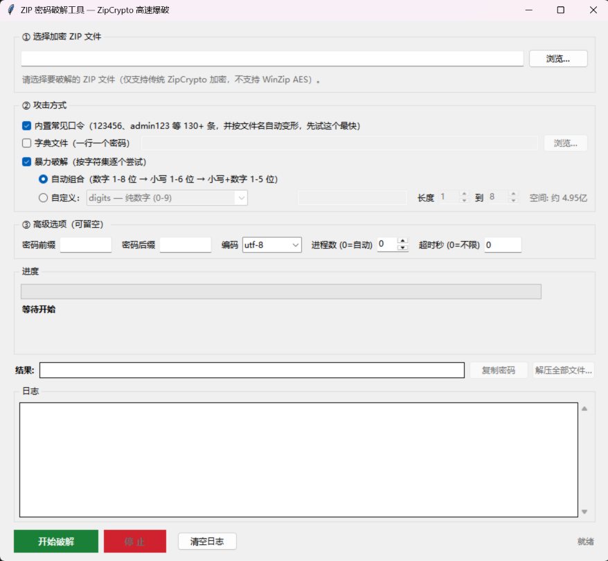

# zipcrack

高速爆破传统 ZipCrypto 密码：C 语言引擎 + 多进程并行，实测每秒可试上亿个密码；自带图形界面，选文件、配参数、看进度点点鼠标就行。

> ⚠️ 仅支持**传统 ZipCrypto** 加密，**不支持 WinZip AES**。请只用于恢复你自己的文件密码或获得明确授权的场景。

## 界面

| 界面1 | 界面2 |
| --- | --- |
|  |  |

## 特性

- **快**：热循环用 C 实现（ctypes 调用 DLL），多进程跑满 CPU，实测峰值 2 亿次/秒以上
- **稳**：候选密码先过校验字节，再过完整 CRC32，再用第二个文件交叉复核，最后实际解压验证，杜绝误报
- **省心**：内置 130+ 条常见口令，并按压缩包内文件名自动变形扩展（通常数百条），先跑字典再暴力
- **友好**：图形界面实时显示进度条、速度、预计剩余时间，可随时停止；找到密码后可一键复制、一键解压
- **灵活**：字符集预设 / 自定义字符、长度范围、前后缀、外部字典（支持 UTF-8 / GBK）、进程数、超时

## 快速开始

要求：Python 3.9+（Windows，已在 3.11 测试）；无需安装任何第三方包。

### 图形界面（推荐）

```bash
python zipcrack.py
```

不带参数即打开界面（也可以 `python zipcrack_gui.py`）。选择 ZIP 文件后会自动识别加密方式，按提示配置攻击方式，点「开始破解」即可。

仓库自带 `demo.zip`（密码 `20131415`），可用来练手，几秒内即可破出。

### 命令行

```bash
python zipcrack.py test.zip                                  # 默认流程：常见口令 → 数字1-8位 → 小写1-6位 → 小写+数字1-5位
python zipcrack.py test.zip -c digits --min 1 --max 8        # 指定字符集和长度
python zipcrack.py test.zip -c lowerdigit --min 6 --max 6 -j 32
python zipcrack.py test.zip -w wordlist.txt                  # 字典攻击
python zipcrack.py test.zip --prefix admin -c digits --min 2 --max 4
python zipcrack.py --self-test                               # 完整自检（引擎正确性 + 多进程破解）
```

## 命令行参数

| 参数 | 说明 | 默认 |
| --- | --- | --- |
| `zip_path` | 要破解的 ZIP 文件 | 不带参数时打开图形界面 |
| `-c, --charset` | 字符集预设名，或直接写自定义字符（如 `abc123`） | 无 |
| `--min / --max` | 密码长度范围（1–16） | 按字符集自动（见下表） |
| `-w, --wordlist` | 字典文件，一行一个密码（自动识别 UTF-8 / GBK） | 无 |
| `--prefix / --suffix` | 给每个候选密码加固定前缀 / 后缀 | 空 |
| `--encoding` | 前后缀与字典编码 | `utf-8` |
| `-j, --workers` | 进程数，`0` 按搜索空间自动选择 | `0` |
| `--timeout` | 总超时秒数，`0` 不限 | `0` |
| `--common / --no-common` | 强制启用 / 跳过常见口令字典 | 默认流程启用 |
| `--gui` | 打开图形界面 | — |
| `--self-test` | 用已知密码做完整自检 | — |

## 字符集预设

| 预设 | 字符 | 大小 | 自动最大长度 |
| --- | --- | --- | --- |
| `digits` | `0-9` | 10 | 8 |
| `lower` | `a-z` | 26 | 6 |
| `upper` | `A-Z` | 26 | 6 |
| `alpha` | `a-zA-Z` | 52 | 5 |
| `lowerdigit` | `0-9a-z` | 36 | 5 |
| `alnum` | `0-9a-zA-Z` | 62 | 4 |
| `hex` | `0-9a-f` | 16 | 8 |
| `printable` | 全部可打印 ASCII | 95 | 3 |

自定义字符直接作为 `-c` 的参数传入即可（仅限单字节字符；中文密码请用字典）。`--min/--max` 未指定时按上表的自动上限执行。

## 工作原理

1. ZipCrypto 每个加密条目带 12 字节加密头，其最后一个明文字节是校验字节（CRC 高字节或修改时间高字节）。引擎先试这个字节，约 255/256 的错误密码一次比较即被淘汰。
2. 通过校验字节的候选，再把整个条目解密并计算 CRC32 与目录值比对，进一步排除碰撞。
3. 命中后用压缩包内第二个加密文件交叉复核，最后调用标准库真实解压验证，确保结果是能真正解开文件的密码。
4. C 引擎负责批量字典校验和区间爆破；Python 侧负责任务切分、多进程调度（spawn）和进度汇总，进程数按搜索空间自动选择。

### native 引擎

首次运行时会自动寻找 gcc（`PATH` 或 MSYS2 默认安装路径 `C:\msys64\ucrt64\bin`）把 `zipcrack_native.c` 编译为 `zipcrack_native.dll`，之后复用；源文件更新会自动重编译，加载时还有版本号自检。没有 gcc 时自动回退到纯 Python 引擎，功能相同但速度慢很多。手动编译命令：

```bash
gcc -O3 -march=native -std=c11 -Wall -shared -static-libgcc -s -o zipcrack_native.dll zipcrack_native.c
```

## 性能

测试机 32 逻辑核，对真实加密 ZIP 的实测数据（native 引擎 + 多进程）：

| 场景 | 搜索空间 | 耗时 | 速度 |
| --- | --- | --- | --- |
| 纯数字 8 位跑满 | 1.0 亿 | ≈ 1 秒 | 约 1.1 亿次/秒 |
| 小写字母 6 位跑满 | 3.1 亿 | ≈ 1.7 秒 | 峰值约 2.2 亿次/秒 |
| 常见口令 412 条 | 412 | 瞬间 | 约 190 万次/秒 |

实际速度取决于 CPU 核数与字符集；GUI 中会实时显示当前速度。

## 限制

- 不支持 WinZip AES（GUI 会识别并提示 AES 条目数量）
- 需要压缩包内至少有一个**存储型（Store，未压缩）**的 ZipCrypto 条目用于稳定的高速 CRC 校验；纯 Deflate 压缩的加密包暂不支持
- 暴力字符集仅限单字节字符；中文等多字节密码请使用字典攻击

## 文件说明

| 文件 | 说明 |
| --- | --- |
| `zipcrack.py` | 命令行入口与破解核心（引擎加载、任务调度、校验逻辑） |
| `zipcrack_gui.py` | 图形界面（tkinter，无第三方依赖） |
| `zipcrack_native.c` | C 语言热循环引擎源码 |
| `zipcrack_native.dll` | 自动编译生成的引擎（可由 gcc 重新构建） |
| `demo.zip` | 演示用加密包，密码 `20131415` |
| `docs/images/` | README 截图 |

## 免责声明

本工具仅供恢复本人所有文件的密码，或在获得明确书面授权的安全测试中使用。使用本工具尝试访问他人数据可能违反法律，作者不承担任何滥用责任。

## 许可证

MIT License
